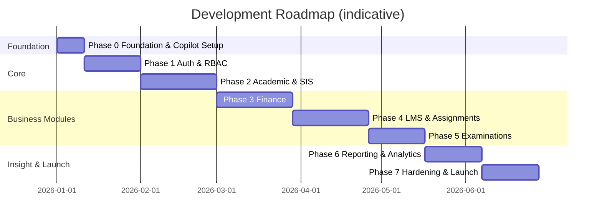

# Advanced School Management System: GitHub Copilot Development Roadmap

A phased, milestone-driven roadmap for building a university/school management system with **GitHub Copilot**. Heavy modules are split into small micro-phases so Copilot gets tight context, produces fewer hallucinations, stays within premium-request limits, and every step ends in a testable, committable, **documented** result.

> **Two standing rules apply to every step in this roadmap:**
>
> 1. **Document every step** of development (what was built, why, how to run and test it).
> 2. **Always comment code**: every block, function, class, and non-obvious line (see [Section 6](#6-documentation--code-commenting-standards)).
>
> **All UI follows one brand palette** (including status and warning colors) defined in [Section 5](#5-design-system--brand-tokens).
>
> **Payments:** the live payment process is **physical**: the student pays at the bank and **Finance records the payment and issues the receipt**. Paying **online from the system (card, bank, mobile money) shows "Coming soon"** until each method is activated later behind its own feature flag (see [Phase 3](#phase-3--finance-module)).

---

## Table of Contents

1. [Vision & Scope](#1-vision--scope)
2. [Tech Stack](#2-tech-stack)
3. [Environment Strategy](#3-environment-strategy)
4. [Copilot Operating Model](#4-copilot-operating-model)
5. [Design System & Brand Tokens](#5-design-system--brand-tokens)
6. [Documentation & Code Commenting Standards](#6-documentation--code-commenting-standards)
7. [Roadmap Overview](#7-roadmap-overview)
8. [Phase 0: Foundation & Copilot Setup](#phase-0--foundation--copilot-setup)
9. [Phase 1: Authentication & RBAC](#phase-1--authentication--rbac)
10. [Phase 2: Core Academic & SIS](#phase-2--core-academic--student-information-system)
11. [Phase 3: Finance Module](#phase-3--finance-module)
12. [Phase 4: LMS & Assignments](#phase-4--lms--assignment-system)
13. [Phase 5: Examination System](#phase-5--examination-system)
14. [Phase 6: Reporting & Analytics](#phase-6--reporting--analytics)
15. [Phase 7: Hardening & Launch](#phase-7--hardening--launch)
16. [Definition of Done](#definition-of-done-per-micro-phase)
17. [Risk Register](#risk-register)

---

## 1. Vision & Scope

### Core University Management Features

| Module | Responsibilities |
|---|---|
| **Academic Management** | Course registration, class scheduling, timetabling, syllabus tracking |
| **Student Information System (SIS)** | Centralized student records, admissions data, enrollment history |
| **Examinations & Grading** | Exam seating, digital assessment, invigilation, GPA/transcript generation |
| **Finance & Billing** | Tuition fees, automated invoices, ledgers, payment records |
| **LMS Integration** | Course materials, assignments, lesson plans linked to enrolled students |

### Student Portal Features

- **Self-Registration:** enroll in semesters, modules, or retakes online without paper forms.
- **Academic Results:** semester grades, academic standing, transcripts.
- **Financial Statements:** balances, paid invoices, payment reference numbers.
- **Timetables & Attendance:** personal class schedules and attendance records.

---

## 2. Tech Stack

| Layer | Top Choice | Why It Works Best |
|---|---|---|
| **Frontend (Portal)** | **Next.js (React)** + **Tailwind CSS** | Fast loads, mobile-responsive for students on smartphones, SSR for dashboards |
| **Backend (API)** | **NestJS (Node.js)** or **Django (Python)** | NestJS enforces clean architecture for complex modules; Django offers a built-in admin and strong security |
| **Database** | **PostgreSQL** | ACID compliance keeps grades and fee balances consistent |
| **ORM** | **Prisma** (NestJS path) | Typed schema, migrations, great Copilot context |
| **Caching & Queues** | **Redis** | Absorbs spikes on registration and results days |
| **Authentication** | **Keycloak** or **Auth0** | RBAC separating students, lecturers, bursars, registrars |
| **Cloud & Storage** | **AWS / DigitalOcean** + **S3** | Scalable hosting and secure object storage for IDs, transcripts, PDFs |
| **Email** | **Resend** | Verification and recovery emails |
| **UI Kit** | **shadcn/ui**, React Hook Form, TanStack Query, Recharts | Consistent, composable frontend |
| **CI/CD** | **GitHub Actions** | Native fit with Copilot and the GitHub workflow |

---

## 3. Environment Strategy

| Stage | Storage | Purpose |
|---|---|---|
| **Local Dev** | **MinIO** (Docker) | Same API as S3, zero cost; upload photos and PDFs locally |
| **Staging / Demo** | **Cloudflare R2** (10 GB free) or Supabase | Show the portal online to stakeholders |
| **Production** | Paid **Cloudflare R2** or **AWS S3** | Swap environment variables only, with no application code changes |

> Keep storage behind an interface (`StorageService`) so switching providers is purely configuration.

---

## 4. Copilot Operating Model

### 4.1 Pick the Right Copilot Mode

| Mode | Use It For | Avoid It For |
|---|---|---|
| **Inline completions** | Boilerplate, DTOs, small functions, repetitive tests | Architecture decisions |
| **Ask (Chat)** | Explaining code, design questions, reviewing a plan | Generating many files |
| **Edit mode** | Targeted multi-file changes in files you explicitly select | Open-ended refactors |
| **Agent mode** | Well-scoped tasks with clear acceptance criteria, **after** the schema and conventions are stable | Early exploration; schema design; anything touching many modules at once |
| **Copilot coding agent** (issue → PR) | Isolated, well-specified issues (tests, CRUD endpoints, docs) | Ambiguous or security-critical work |
| **Copilot code review** | A first-pass review on every pull request | Replacing human review of finance and auth logic |

### 4.2 Prompting Rules

1. **Never generate frontend and backend together.**
2. **Separate Prisma schema generation from APIs.**
3. **Generate services separately from controllers.**
4. **Generate RBAC and validation separately.**
5. **Generate tests separately.**
6. **Avoid Agent mode during early development;** use Ask and Edit until conventions are locked.
7. **Keep prompts under ~250 words.**
8. **Attach context explicitly** using `#file`, `#selection`, or `@workspace`, and always include `RBAC_MATRIX.md` and `DATABASE_SCHEMA.md`.
9. **Say what NOT to do:** "Do not modify existing files. Do not generate APIs yet."
10. **Commit after every successful micro-phase.**
11. **Start a fresh chat per micro-phase** to keep context clean and avoid drift.
12. **Review diffs before accepting.** Never accept large generated files blindly.
13. **Always require code comments.** Every prompt must result in commented code (file header, doc-comments on every function/class, block comments on logic). The rule lives in `copilot-instructions.md` and is repeated in each prompt footer.
14. **Document every step.** After each micro-phase, run the step-documentation prompt and commit the result with the code.
15. **Frontend prompts must reference `#file:docs/DESIGN_SYSTEM.md`** and use only the semantic color tokens, never raw hex values.

### 4.3 Repository Instruction Files

Give Copilot persistent project knowledge so you do not repeat yourself in every prompt.

```text
.github/
├── copilot-instructions.md          # Repo-wide conventions (always applied)
├── instructions/
│   ├── backend.instructions.md      # applyTo: "apps/api/**"
│   ├── frontend.instructions.md     # applyTo: "apps/web/**"
│   ├── prisma.instructions.md       # applyTo: "**/*.prisma"
│   └── tests.instructions.md        # applyTo: "**/*.spec.ts"
├── prompts/                         # Reusable prompt files, one per micro-phase
│   ├── 01-prisma-auth.prompt.md
│   ├── 02-auth-services.prompt.md
│   └── ...
└── workflows/                       # GitHub Actions (CI)
docs/
├── RBAC_MATRIX.md
├── DATABASE_SCHEMA.md
├── ARCHITECTURE.md
├── API_CONVENTIONS.md
├── DESIGN_SYSTEM.md                 # Brand tokens and UI rules (Section 5)
├── DEVELOPMENT_LOG.md               # Chronological log: one entry per step
├── CHANGELOG.md                     # Release-level changes
├── adr/                             # Architecture Decision Records (0001-*.md ...)
└── phases/
    ├── phase-0/                     # One folder per phase
    └── phase-1/
        ├── step-1.1-prisma-schema.md   # One doc per micro-phase step
        └── step-1.2-migration-seed.md
```

**Example `.github/copilot-instructions.md`:**

```markdown
# Project Conventions
- Monorepo: apps/api (NestJS), apps/web (Next.js), packages/shared.
- TypeScript strict mode. No `any`.
- Backend layering: Controller → Service → Repository (Prisma). Controllers hold no business logic.
- All DTOs validated with class-validator. All endpoints guarded by RBAC decorators.
- Money is stored as integer minor units (never floats).
- Never regenerate or overwrite existing files unless explicitly asked.
- Every service ships with a matching *.spec.ts in a separate step.
- Read docs/RBAC_MATRIX.md and docs/DATABASE_SCHEMA.md before generating code.

# Commenting (mandatory, no exceptions)
- Every file starts with a header comment: purpose, module, and who/what uses it.
- Every exported class, function, DTO, and React component has a TSDoc block
  (summary, @param, @returns, @throws).
- Add a short comment above every logical block explaining WHY, not just WHAT.
- Reference the business rule being enforced (e.g. "Rule: min 60% fees paid").
- Prisma models and fields use /// doc comments.
- Tests use Arrange / Act / Assert comments.
- Do not delete existing comments; update them when behavior changes.

# Documentation (mandatory)
- After each micro-phase, produce docs/phases/phase-N/step-N.M-<name>.md
  and append an entry to docs/DEVELOPMENT_LOG.md.

# UI / Brand
- Use only the semantic color tokens in docs/DESIGN_SYSTEM.md
  (brand, accent, badge, surface, card, ink, line, field, success, warning, error, info
  and their -soft tints). Never hardcode hex values.

# Payments
- ACTIVE: physical payments. The student pays at the bank; Finance records the
  deposit (bank, deposit-slip reference, amount, date) and the system issues a receipt.
- COMING SOON: online card, bank, and mobile-money payments. Each is behind its own
  feature flag (payments.online.card / .bank / .mobile), default OFF. While OFF the API
  returns 403 FEATURE_DISABLED with comingSoon: true and the UI shows a "Coming soon"
  badge. Never enable these flags in code or seed data.
```

### 4.4 Reusable Prompt File Template

Store each micro-phase prompt as `.github/prompts/<name>.prompt.md` so it is versioned, reviewable, and reusable.

```markdown
---
mode: 'ask'
description: 'Phase 1, Step 1: Prisma schema for auth and RBAC'
---
Context: #file:docs/DATABASE_SCHEMA.md #file:docs/RBAC_MATRIX.md

Create Prisma models for authentication and RBAC:
- users, roles, permissions, sessions
- password_reset_tokens, email_verification_tokens

Include relationships, indexes, enums, timestamps.
Constraints: do NOT generate APIs. Do NOT modify existing models.
```

### 4.5 Quota Management

- Use the lighter included model for boilerplate and completions; reserve premium models for architecture, complex finance logic, and debugging.
- Prefer Edit mode with narrow file selection over Agent mode, which can consume far more requests.
- Batch related questions into one prompt instead of many small ones.
- Check your Copilot usage dashboard weekly and adjust.

---

## 5. Design System & Brand Tokens

All frontends (Phases 1 to 6) follow a single palette. These tokens are the **single source of truth**: they live in `docs/DESIGN_SYSTEM.md`, are implemented once in the Tailwind theme and global CSS, and are referenced in components by **semantic name**, never by raw hex value.

### 5.1 Color Tokens

| Token | Hex | Name | Role |
|---|---|---|---|
| `brand` | `#312E81` | Deep Indigo | Primary brand color: the **navigation rail**, page titles, active-state accents |
| `accent` | `#4F46E5` | Electric Indigo | Interactive accent: **primary CTAs** (buttons), links, focus rings |
| `badge` | `#0D9488` | Teal | **GPA and attendance badges** and other positive academic indicators |
| `surface` | `#F9FAFB` | Soft Neutral Gray | Page background |
| `card` | `#FFFFFF` | White | Cards, tables, modals, form panels |
| `ink` | `#111827` | Charcoal | Body text and headings on light surfaces |
| `line` | `#E5E7EB` | Border Gray | Borders, dividers, table rules |

### 5.1b Status & Warning Tokens

Added to cover success, caution, error, and informational states (payment failures, exam blocking, deadline warnings, "coming soon" notices, form validation). Each status has a **strong** color (text, icons, borders) and a **soft** tint (banner and badge backgrounds).

| Token | Hex | Name | Role |
|---|---|---|---|
| `success` | `#15803D` | Green | Positive status: paid, approved, published, saved |
| `success-soft` | `#DCFCE7` | Green Tint | Background for success banners and chips |
| `warning` | `#B45309` | Amber | Caution: approaching deadline, low attendance, eligibility at risk |
| `warning-soft` | `#FEF3C7` | Amber Tint | Background for warning banners and chips |
| `error` | `#B91C1C` | Red | Errors, failed actions, blocked exams, destructive buttons |
| `error-soft` | `#FEE2E2` | Red Tint | Background for error banners and field errors |
| `info` | `#4F46E5` | Electric Indigo (same as `accent`) | Neutral notices, including **"Coming soon"** badges and banners |
| `info-soft` | `#EEF2FF` | Indigo Tint | Background for info banners |
| `field` | `#6B7280` | Field Gray | Input and form-control borders (meets 3:1 non-text contrast) |

### 5.2 Usage Rules

| Element | Rule |
|---|---|
| **Navigation rail** | Background `brand`; white icons and labels; the active item uses a translucent white overlay (no new colors) |
| **Primary CTA** | Background `accent`, white text; limit to **one primary CTA per view**; hover and pressed states use brightness changes, not new hues |
| **Badges** | `badge` (teal) is **reserved** for GPA and attendance indicators. Do not use it for generic buttons or alerts |
| **Page and cards** | Page background `surface`; content sits on `card` with a 1px `line` border |
| **Text** | `ink` for primary text; secondary text uses `ink` at reduced opacity (for example `text-ink/70`) instead of introducing a new gray |
| **Charts (Recharts)** | Primary series `accent`, secondary series `badge`; any additional series colors must be added to `DESIGN_SYSTEM.md` before use |
| **Focus** | Visible focus ring in `accent` on every interactive element |
| **Status messages** | Pair the strong color with its soft tint, an **icon**, and a **text label** (never color alone). Example: `error` text and icon on an `error-soft` banner |
| **Teal vs green** | `badge` (teal) stays reserved for GPA and attendance. Use `success` (green) for paid, approved, and published states. Low attendance uses `warning`, not teal |
| **Destructive actions** | Delete, revoke, and reject buttons use `error`; a screen still has only one primary CTA (`accent`) |
| **Coming-soon features** | Show a "Coming soon" badge (`info` text on `info-soft`) and a disabled control using `line` background with `ink` at reduced opacity, plus a short message pointing to the available alternative; never hide the option, break the layout, or show an error |
| **Form fields** | Border `field`; error state uses `error` border plus message; focus uses `accent` ring |

### 5.3 Accessibility Notes

Approximate contrast ratios against white or the stated background:

| Pairing | Ratio | Verdict |
|---|---|---|
| White on `brand` | about 11:1 | Passes AA and AAA |
| White on `accent` | about 6.3:1 | Passes AA |
| `ink` on `surface` | about 17:1 | Passes AAA |
| White on `badge` (teal) | about 3.7:1 | **Below 4.5:1 for small text.** Use only for large or bold text (14pt bold or larger), or always pair the badge with an icon and a text label |
| `line` as a form-field border | about 1.2:1 | Fine for decorative dividers only; **input borders use `field` instead** |
| `field` border on white | about 4.8:1 | Passes the 3:1 non-text requirement |
| `success` text on white / on `success-soft` | about 5.0:1 / 4.6:1 | Passes AA |
| `warning` text on white / on `warning-soft` | about 5.0:1 / 4.5:1 | Passes AA (narrow margin on the tint; do not go lighter) |
| `error` text on white / on `error-soft` | about 6.5:1 / 5.3:1 | Passes AA |
| `accent` (info) text on `info-soft` | about 5.6:1 | Passes AA |

> **Note:** status colors are never the only signal. Every status also carries an icon and a text label so it is readable by users with color-vision differences.

### 5.4 Implementation (Tailwind + CSS Variables)

**`apps/web/tailwind.config.ts`**

```ts
// apps/web/tailwind.config.ts
// Single source of truth for brand colors.
// Components MUST use these semantic names (bg-brand, text-ink, ...)
// and never raw hex values, so a rebrand is a one-file change.
import type { Config } from "tailwindcss";

const config: Config = {
  // Tell Tailwind where to look for class names
  content: ["./src/**/*.{ts,tsx}"],
  theme: {
    extend: {
      colors: {
        brand: "#312E81",   // Deep Indigo: navigation rail
        accent: "#4F46E5",  // Electric Indigo: primary CTAs, links, focus rings
        badge: "#0D9488",   // Teal: GPA / attendance badges only
        surface: "#F9FAFB", // Soft Neutral Gray: page background
        card: "#FFFFFF",    // Cards, tables, modals
        ink: "#111827",     // Charcoal: text
        line: "#E5E7EB",    // Borders and dividers
        field: "#6B7280",   // Input / form-control borders (3:1+ contrast)

        // ---- Status & warning colors (strong = text/icons, soft = backgrounds) ----
        success: { DEFAULT: "#15803D", soft: "#DCFCE7" }, // paid, approved, published
        warning: { DEFAULT: "#B45309", soft: "#FEF3C7" }, // caution, at-risk, near deadline
        error:   { DEFAULT: "#B91C1C", soft: "#FEE2E2" }, // failures, blocked, destructive
        info:    { DEFAULT: "#4F46E5", soft: "#EEF2FF" }, // notices, "coming soon"
      },
    },
  },
  plugins: [],
};

export default config;
```

**`apps/web/src/app/globals.css`** (maps the tokens onto shadcn/ui's semantic variables)

```css
/* apps/web/src/app/globals.css
   Map brand tokens onto the CSS variables shadcn/ui components read.
   NOTE: the exact variable format (HSL triplet vs full color value) depends on
   your shadcn/ui version. Keep the generated format and convert the hex values. */
:root {
  --background: #F9FAFB;          /* surface: page background */
  --foreground: #111827;          /* ink: default text */
  --card: #FFFFFF;                /* card: panels, tables, modals */
  --card-foreground: #111827;     /* ink on cards */
  --primary: #4F46E5;             /* accent: primary buttons */
  --primary-foreground: #FFFFFF;  /* text on primary buttons */
  --border: #E5E7EB;              /* line: borders and dividers */
  --ring: #4F46E5;                /* accent: focus ring */
  --sidebar: #312E81;             /* brand: navigation rail */
  --sidebar-foreground: #FFFFFF;  /* text and icons on the rail */
  --badge: #0D9488;               /* GPA / attendance badges */

  /* Status colors (strong for text/icons, soft for backgrounds) */
  --input: #6B7280;               /* field: input borders */
  --success: #15803D;             --success-soft: #DCFCE7;
  --warning: #B45309;             --warning-soft: #FEF3C7;
  --destructive: #B91C1C;         /* shadcn's name for the error color */
  --destructive-soft: #FEE2E2;
  --info: #4F46E5;                --info-soft: #EEF2FF;
}
```

> Tailwind v4 projects declare the same tokens with an `@theme` block in CSS instead of `tailwind.config.ts`. Use whichever matches your installed version.

---

## 6. Documentation & Code Commenting Standards

> **Rule 1: Document every step of development.**
> **Rule 2: Always comment code, in every block and wherever clarity is needed.**

Both rules are enforced by the Copilot instruction files, the PR template, linting, and the Definition of Done.

### 6.1 What Gets Documented

| Artifact | Location | When |
|---|---|---|
| **Step document** | `docs/phases/phase-N/step-N.M-<name>.md` | At the end of **every** micro-phase |
| **Development log entry** | `docs/DEVELOPMENT_LOG.md` | Every step (newest first) |
| **Architecture Decision Record** | `docs/adr/NNNN-<decision>.md` | Whenever a significant choice is made (library, pattern, trade-off) |
| **Schema and RBAC docs** | `docs/DATABASE_SCHEMA.md`, `docs/RBAC_MATRIX.md` | Whenever models or permissions change |
| **API docs** | OpenAPI/Swagger decorators plus `docs/API_CONVENTIONS.md` | Alongside each endpoint |
| **Design tokens** | `docs/DESIGN_SYSTEM.md` | Whenever UI tokens or patterns change |
| **Changelog** | `docs/CHANGELOG.md` | At each release or phase completion |
| **Runbooks** | `docs/RUNBOOK.md` | Deployment, backup, rollback, incidents |

### 6.2 Step Document Template

Every micro-phase ends with a document in this shape (Copilot drafts it; a human reviews it):

```markdown
# Step 3.4: Payment Logic

- **Phase / Step:** Phase 3, Step 4
- **Date / Author:** YYYY-MM-DD, <name>
- **Branch / PR:** feature/finance-payment-logic, #42

## Goal
One or two sentences on what this step delivers and why it exists.

## What Was Built
- Files created or changed (with paths)
- Public functions/endpoints added

## Key Decisions & Trade-offs
- Decision, alternatives considered, reason chosen (link ADR if one exists)

## Business Rules Implemented
- e.g. "Overpayments carry forward to the next term"

## How to Run & Test
- Exact commands (migrate, seed, test) and expected output

## Data / Permissions Impact
- Tables or columns touched; roles affected (RBAC_MATRIX.md updated: yes/no)

## Known Limitations & Follow-ups
- Anything deferred, with a TODO reference

## Copilot Usage
- Prompt file used, mode, and what needed manual correction
```

### 6.3 Code Commenting Rules

| Where | Required comment |
|---|---|
| **Every file** | Header comment: purpose, module, and what depends on it |
| **Every exported class, function, DTO, hook, component** | TSDoc block with summary, `@param`, `@returns`, `@throws` (and prop descriptions for components) |
| **Every logical block** | A short comment above it explaining **why** it exists, not a restatement of the code |
| **Business rules** | Name the rule in the comment (for example "Rule: students need at least 60% of fees paid to sit exams") |
| **Prisma models and fields** | `///` doc comments (they also flow into generated docs and types) |
| **Complex queries, regexes, math** | Step-by-step comment with an example input and output |
| **Security-sensitive code** | Comment the threat being prevented (for example "prevents IDOR: user may only read OWN record") |
| **Workarounds and TODOs** | `// TODO(name, #issue): what and why`; never leave a bare TODO |
| **Tests** | Arrange / Act / Assert comments and a sentence describing the scenario |
| **Config, env vars, Docker, CI** | Comment every non-obvious setting and unit |

**Do not** comment the trivially obvious (`i++ // add one`), leave stale comments after behavior changes, or delete existing comments without replacing them.

### 6.4 Example: The Expected Commenting Style

```ts
// apps/api/src/finance/payment.service.ts
// Purpose: records bank-deposit payments entered by Finance and keeps balances consistent.
// Used by: PaymentController, ExamEligibilityService (fee-percentage check).
// NOTE: online methods (card, bank, mobile) are COMING SOON; see OnlinePaymentController.

import { BadRequestException, ConflictException, Injectable } from "@nestjs/common";
import { PrismaService } from "../prisma/prisma.service";
import { RecordBankDepositDto } from "./dto/record-bank-deposit.dto";

/**
 * Handles payments that Finance records after a student pays at the bank.
 * All amounts are integers in minor units (e.g. cents) to avoid float drift.
 */
@Injectable()
export class PaymentService {
  constructor(private readonly prisma: PrismaService) {}

  /**
   * Records a bank-deposit payment so a receipt can be issued.
   *
   * @param dto - Student, invoice, amount, bank name, deposit-slip reference, deposit date.
   * @param recordedById - The finance officer entering the payment (audit trail).
   * @returns The stored payment.
   * @throws BadRequestException if the amount is not a positive integer.
   * @throws ConflictException if this deposit slip was already recorded.
   */
  async recordBankDeposit(dto: RecordBankDepositDto, recordedById: string) {
    // Rule: payments must be positive whole minor units.
    if (!Number.isInteger(dto.amountMinor) || dto.amountMinor <= 0) {
      throw new BadRequestException("Amount must be a positive integer.");
    }

    // Run every write in ONE transaction so a failure can never leave a
    // payment saved without its balance update and audit log entry.
    return this.prisma.$transaction(async (tx) => {
      // 1. Duplicate protection: one bank deposit slip may be recorded only once.
      const duplicate = await tx.payment.findFirst({
        where: { bankName: dto.bankName, bankReference: dto.bankReference },
      });
      if (duplicate) {
        throw new ConflictException("This deposit slip has already been recorded.");
      }

      // 2. Persist the payment; the method is fixed because this is the physical flow.
      const payment = await tx.payment.create({
        data: { ...dto, method: "BANK_DEPOSIT", recordedById },
      });

      // 3. Append to the immutable transaction log (audit trail).
      await tx.transactionLog.create({
        data: { paymentId: payment.id, action: "PAYMENT_RECORDED", actorId: recordedById },
      });

      return payment;
    });
  }
}
```

```ts
// apps/api/src/finance/online-payment.controller.ts
// Purpose: entry points for online payments. Card, bank and mobile are COMING SOON.

@Controller("payments/online")
export class OnlinePaymentController {
  constructor(private readonly onlinePayments: OnlinePaymentService) {}

  /**
   * Starts an online payment for the chosen method.
   * While the method's flag (payments.online.<method>) is OFF, the guard answers
   * 403 { code: "FEATURE_DISABLED", comingSoon: true } and this body never runs.
   */
  @Post(":method/initiate")
  @UseGuards(JwtAuthGuard, OnlineMethodFlagGuard)
  initiate(@Param("method") method: OnlineMethod, @CurrentUser() user: AuthUser) {
    // Reached only after this method has been activated and its gateway integrated.
    return this.onlinePayments.initiate(method, user.id);
  }
}
```

### 6.5 Enforcement

| Mechanism | How |
|---|---|
| **Copilot instructions** | The commenting, documentation, and brand rules in `.github/copilot-instructions.md` apply to every chat automatically |
| **Prompt footers** | Every prompt in the prompt library ends with the mandatory comment and documentation rule |
| **Linting** | `eslint-plugin-jsdoc` (require doc blocks on exported members) plus a lint rule against raw hex colors in components |
| **PR template** | Checklist: step doc added, log updated, code commented, schema and RBAC docs updated |
| **CI check** | Optional job that fails a PR when `src/` changes without a matching change under `docs/` |
| **Copilot code review** | Configure review instructions to flag uncommented or undocumented code |

---

## 7. Roadmap Overview



| Phase | Theme | Depends On | Key Deliverable |
|---|---|---|---|
| 0 | Foundation & Copilot setup | none | Repo, CI, conventions, instruction files |
| 1 | Auth & RBAC | 0 | Secure login, roles, permissions |
| 2 | Academic & SIS | 1 | Students, courses, enrollment, timetable |
| 3 | Finance | 2 | Fees, invoices, **bank-deposit payments recorded by Finance**, receipts, statements; online card/bank/mobile payments show **Coming soon** |
| 4 | LMS & Assignments | 2 | Assignments, uploads, submissions, grading |
| 5 | Examinations | 3, 4 | Exams with fee and assignment eligibility rules |
| 6 | Reporting & Analytics | 3, 4, 5 | Dashboards and PDF exports |
| 7 | Hardening & Launch | all | Security, performance, deployment |

> **Every micro-phase in every phase ends with a documentation step** (Section 6): step document, development-log entry, and commented code.

> Phases 3 and 4 can run in parallel if you have two developers, since both depend only on Phase 2.

---

## Phase 0: Foundation & Copilot Setup

**Goal:** a clean repo where Copilot has everything it needs to produce consistent code.

| # | Task | Tool / Mode | Output |
|---|---|---|---|
| 0.1 | Create monorepo (`apps/api`, `apps/web`, `packages/shared`) | Manual | Repo skeleton |
| 0.2 | Docker Compose: PostgreSQL, Redis, MinIO | Ask → Edit | `docker-compose.yml` |
| 0.3 | Write `copilot-instructions.md` and scoped `*.instructions.md` | Manual | Conventions locked |
| 0.4 | Write `RBAC_MATRIX.md`, `DATABASE_SCHEMA.md`, `ARCHITECTURE.md` | Ask (draft), human review | Context docs |
| 0.5 | GitHub Actions: lint, type-check, test, build | Edit | `.github/workflows/ci.yml` |
| 0.6 | Branch protection, PR template, issue templates, Copilot code review enabled | Manual | Governance |
| 0.7 | ESLint, Prettier, Husky, Conventional Commits, `eslint-plugin-jsdoc` | Edit | Quality gates incl. comment enforcement |
| 0.8 | Brand tokens: Tailwind theme, global CSS variables, `docs/DESIGN_SYSTEM.md` (Section 5) | Edit | Single source of truth for UI colors |
| 0.9 | Documentation scaffold: `docs/phases/`, `DEVELOPMENT_LOG.md`, `CHANGELOG.md`, `adr/`, PR template with doc checklist | Edit | Documentation workflow ready |

**Exit criteria:** `docker compose up` works; CI is green on an empty app; Copilot responds in line with the instruction files; brand tokens and documentation scaffold are in place.

---

## Phase 1: Authentication & RBAC

**Goal:** secure identity and fine-grained authorization before any business data exists.

| Step | Micro-Phase | Mode | Prompt Focus | Constraint |
|---|---|---|---|---|
| 1.1 | **Prisma Schema** | Ask / Edit | users, roles, permissions, sessions, password_reset_tokens, email_verification_tokens; relations, indexes, enums, timestamps | No APIs yet |
| 1.2 | **Migration** | Manual | `prisma migrate dev`, seed roles and permissions | Run before generating APIs |
| 1.3 | **Auth Services** | Edit | login, register, refresh token, logout, password hashing, JWT generation | No frontend code |
| 1.4 | **RBAC Guards** | Edit | role guards, permission guards, decorators, authorization middleware | Prevent unauthorized access |
| 1.5 | **Password Recovery** | Edit | forgot/reset password, email verification, token expiry, resend verification via Resend | Separate from 1.3 |
| 1.6 | **Auth Tests** | Edit | unit and e2e tests for login, refresh, guards, expiry | Tests only |
| 1.7 | **Frontend Auth UI** | Edit | login, forgot password, reset password, email verification pages (shadcn/ui, React Hook Form, TanStack Query, brand tokens from Section 5) | Backend must be tested first |

**Security checklist:** Argon2/bcrypt hashing; short-lived access tokens with rotating refresh tokens; rate limiting on auth endpoints; no secrets in the repo.

**Exit criteria:** all roles (student, lecturer, bursar, registrar, admin) can log in; protected routes reject unauthorized roles; auth test suite passes in CI. Every step is documented and all code is commented.

---

## Phase 2: Core Academic & Student Information System

**Goal:** the data backbone that Finance, LMS, and Exams all depend on.

| Step | Micro-Phase | Focus |
|---|---|---|
| 2.1 | **Academic Schema** | academic_years, terms/semesters, programs, courses, classes, enrollments, students, lecturers |
| 2.2 | **Migration & Seed** | Sample programs, courses, and terms |
| 2.3 | **SIS APIs** | Student records, admissions data, enrollment history |
| 2.4 | **Course Registration Logic** | Self-registration, retakes, prerequisites, capacity checks |
| 2.5 | **Timetable & Attendance Services** | Scheduling, clash detection, attendance recording |
| 2.6 | **Tests** | Registration rules, clash detection, enrollment history |
| 2.7 | **Student Portal UI** | Profile, registration, timetable, attendance pages |
| 2.8 | **Admin/Registrar UI** | Student management, course and class management |

**Exit criteria:** a student can self-register for a semester; a registrar can manage records; the timetable shows no clashes. Every step is documented and all code is commented.

---

## Phase 3: Finance Module

**Goal:** accurate, auditable money handling. This is the highest-risk module, so use the strictest review.

> **How payments work in this system**
>
> - **Active now (physical payment):** the student pays at the bank. **Finance records the deposit and issues the receipt.** Students cannot record their own payments.
> - **Coming soon (online payment):** if a student tries to pay from the system by **card, online bank, or mobile money**, the system shows **"Coming soon"** and points them to the bank-deposit steps. Each online method sits behind its own feature flag, **OFF by default**.

### Payment Channels

| Channel | Status | Feature Flag | What the user sees |
|---|---|---|---|
| **Bank deposit, recorded by Finance** (physical) | **ACTIVE** | none (core feature) | Reference number, bank details, receipt from Finance |
| **Card** (online) | **COMING SOON** | `payments.online.card` (OFF) | "Coming soon" badge, disabled button |
| **Online bank payment** | **COMING SOON** | `payments.online.bank` (OFF) | "Coming soon" badge, disabled button |
| **Mobile money** | **COMING SOON** | `payments.online.mobile` (OFF) | "Coming soon" badge, disabled button |

### The Physical Payment Workflow (Active)

1. **Reference number:** the student generates a unique **payment reference** in the portal (tied to student, term, and invoice) and writes it on the bank deposit slip.
2. **Bank deposit:** the student pays into the school's bank account. The portal shows the bank name, account details, and instructions (loaded from configuration).
3. **Finance verification:** the student brings the deposit slip to Finance (or Finance matches the reference on the bank statement).
4. **Finance records the payment:** student, invoice or term, amount, bank name, **deposit-slip/bank reference**, deposit date, and an optional scan of the slip. The system **rejects a duplicate bank reference**.
5. **Receipt issued:** the system updates the balance, carry-forward, and fee-paid percentage, then generates a **sequentially numbered PDF receipt** (school logo watermark) that Finance prints and hands to the student. The student can also download it from the portal.
6. **Corrections:** payments are **never deleted**. A mistake is fixed by **voiding with a written reason**, which creates a reversing log entry and marks the receipt `VOID`; a corrected payment then gets a new receipt. Voiding needs a different approver from the person who recorded the payment (maker-checker).
7. **Reconciliation:** Finance can run a **daily bank-deposit report** to reconcile recorded payments against the bank statement.

### Online Payments: "Coming Soon" Behavior

| Layer | Behavior while a method is OFF |
|---|---|
| **Student UI** | A **Pay online** section lists Card, Online bank, and Mobile money, each with a **"Coming soon"** badge (`info` colors) and a disabled button. Beside it, a **"How to pay now"** panel explains the bank-deposit steps. Nothing looks broken and no error appears |
| **API** | Online endpoints exist and are guarded by `@RequireFeature('payments.online.<method>')`. They return `403` with `{ "code": "FEATURE_DISABLED", "comingSoon": true, "method": "card", "message": "Card payments are coming soon. Please pay at the bank and collect your receipt from Finance." }` |
| **Defense in depth** | The online payment service checks the flag too, so no background job or other module can start an online payment |
| **Who can toggle** | Admin only, per method, with a written reason; every change is saved to the append-only `FeatureFlagAudit` table |
| **Source of truth** | The database flag value (activation needs no redeploy); `.env` values only seed the initial OFF state; cached in Redis (about 30 seconds) |

**Built now:** the three flags, the guard, the online endpoints, the "Coming soon" UI, a `PaymentGateway` interface (initiate, verify, refund), and placeholder adapters for card, bank, and mobile money that deliberately do nothing.

**Deferred until each method is approved:** choosing a payment provider, real gateway integration, webhooks and signature checks, reconciliation with provider reports, and sandbox testing. For cards, use the provider's **hosted checkout** so card numbers never touch your servers.

### Phase 3 Steps

| Step | Micro-Phase | Focus | Notes |
|---|---|---|---|
| 3.0 | **Feature Flag Infrastructure** | `FeatureFlag` and `FeatureFlagAudit` models, `FeatureFlagService`, `@RequireFeature` guard, `GET /features`, admin toggle, frontend `FeatureGate`; flags `payments.online.card`, `.bank`, `.mobile` seeded OFF | Reusable for future modules |
| 3.1 | **Finance Schema + Migration** | fee_structures, invoices, payments (bank name, bank reference, deposit date, recorded-by, void fields), receipts, outstanding and carry-forward balances, transaction_logs | Integer minor units; `PaymentMethod` enum: `BANK_DEPOSIT` plus `CARD`, `ONLINE_BANK`, `MOBILE_MONEY` for later; unique bank reference |
| 3.2 | **Fee Structure APIs** | Create/update fee structure, assign fees per class and term, validate academic year relationships | **Active**; no frontend |
| 3.3 | **Invoice Generation** | Generate and bulk-generate invoices, apply carried-forward amounts, idempotent | **Active** |
| 3.4 | **Payment Logic (Bank Deposits)** | Payment reference generator, record bank-deposit payments, duplicate-slip protection, balances, carry forward excess, outstanding balances, fee-paid percentages, void with reason | **Active**; service layer only |
| 3.5 | **Finance Tests** (early) | Carry-forward, outstanding balances, percentages, duplicate slip, void and re-record, concurrent payments, invalid amounts | Write before receipts |
| 3.6 | **Payment Controller** | Bank-deposit endpoints (record, list, void, statement); online endpoints guarded by the flags | Bursar records; students read own statement only |
| 3.7 | **Receipt Generation** | Printable PDF receipts, school logo watermark, gap-free numbering, transaction references, `VOID` marking | **Active**; Puppeteer or PDFKit |
| 3.8 | **Finance Dashboard UI** | Fee structures, invoices, **record bank deposit form**, payment list, receipt print/history, daily bank-deposit report, fee analytics | Next.js, shadcn/ui, brand and status tokens |
| 3.9 | **Student Financial Statement UI** | Invoices and balance, receipts, **reference number generator, "How to pay now" bank instructions**, **Pay online section with "Coming soon" badges** | Student portal; mobile first |
| 3.10 | **Online Payment Activation** (DEFERRED) | Per-method activation runbook, provider integration checklist, sandbox smoke tests, rollback plan | Document now; **execute only when a method is approved** |
| 3.11 | **Phase Documentation** | Step documents, development log, ADRs (flag design, maker-checker voids) | Required for every phase |

**Cross-module rule:** the exam fee-percentage restriction (Phase 5) is **fully active**, because it reads the payments Finance records from bank deposits.

**Testing rule:** bank-deposit logic gets full unit and integration tests. Separate tests prove that for **each** online method, with its flag OFF, the endpoint returns `403 FEATURE_DISABLED` with `comingSoon: true`, no payment row is created, no receipt number is consumed, and the UI shows the "Coming soon" badge with a disabled button.

**Safeguards:** database transactions for every payment write; immutable `transaction_logs`; unique bank reference to stop duplicate slips; `recordedById` stored on every payment; **no deletes, only void with reason**; maker-checker for voids; **human review mandatory** on all balance calculations.

**Activating an online method later (step 3.10):** pick a provider, build the gateway adapter, test in the provider sandbox, reconcile against provider reports, review security (hosted checkout, webhook signatures), confirm stakeholder approval, enable the method's flag on staging, smoke test, enable on production, then monitor for 48 hours. **Rollback** is switching that method's flag OFF; completed payments remain untouched.

**Exit criteria:** Finance can record a bank deposit and the system issues a correctly numbered receipt; duplicate deposit slips are rejected; balances reconcile against a hand-calculated test ledger; trying to pay online by card, bank, or mobile shows "Coming soon" and creates nothing; the finance test suite passes. Every step is documented and all code is commented.

---

## Phase 4: LMS & Assignment System

**Goal:** assignments, materials, submissions, and grading workflows.

| Step | Micro-Phase | Focus |
|---|---|---|
| 4.1 | **LMS Schema** | assignments, learning_materials, submissions, grading, extension_requests (exams modeled in Phase 5) |
| 4.2 | **Migration** | Apply and verify |
| 4.3 | **Assignment APIs** | Create/update, deadline tracking, visibility per class, approval workflow |
| 4.4 | **File Upload System** | PDF, DOCX, PPTX, image uploads; upload validation; storage via `StorageService` (MinIO → R2/S3) |
| 4.5 | **Submission Logic** | Upload submissions, deadline enforcement, missed-paper tracking, extensions, status tracking |
| 4.6 | **Grading System** | Grade submissions, publish marks, feedback, grading analytics, submission statistics |
| 4.7 | **LMS Tests** | Deadline enforcement, extensions, upload validation, grading rules |
| 4.8 | **LMS Frontend** | Assignments, submissions, reading materials, grading dashboard, teacher upload pages |

**Safeguards:** validate MIME type and size server-side; virus-scan uploads if feasible; pre-signed URLs for downloads; never trust client-supplied file names.

**Exit criteria:** teacher publishes an assignment; student submits before the deadline; late and missed states are tracked; marks are published and visible to the student. Every step is documented and all code is commented.

---

## Phase 5: Examination System

**Goal:** exams gated by business rules from Finance and LMS.

| Step | Micro-Phase | Focus |
|---|---|---|
| 5.1 | **Exam Schema** | exams, exam_submissions, grading, exam_results, exam_restrictions |
| 5.2 | **Migration** | Apply and verify |
| 5.3 | **Exam Creation APIs** | Create and publish exams, class visibility, scheduling, deadline management |
| 5.4 | **Restriction Logic** | Assignment completion checks, fee percentage checks (based on payments recorded by Finance), missed-assignment restrictions, exam blocking |
| 5.5 | **Result Publishing** | Publish results, missed-paper status, result visibility, grading reports |
| 5.6 | **Transcript & GPA Services** | GPA calculation, academic standing, transcript generation |
| 5.7 | **Exam Tests** | Eligibility matrix (fee % × assignment completion), result visibility |
| 5.8 | **Examination Frontend** | Exams dashboard, exam attempts, grading pages, result pages |

**Exit criteria:** a student under the fee threshold or with missed assignments is correctly blocked; results appear only after publishing; transcripts match expected GPAs. Every step is documented and all code is commented.

---

## Phase 6: Reporting & Analytics

**Goal:** turn module data into decisions.

| Step | Micro-Phase | Focus |
|---|---|---|
| 6.1 | **Analytics APIs** | Finance (payments, outstanding balances, daily bank-deposit totals), attendance, assignment, student performance, teacher workload |
| 6.2 | **Chart Data Services** | Monthly revenue, attendance trends, assignment completion trends, performance summaries |
| 6.3 | **Caching Layer** | Redis caching for heavy aggregates; background jobs for precomputation |
| 6.4 | **Dashboard UI** | Charts, cards, tables, filters, export buttons (Recharts, shadcn/ui, Next.js) |
| 6.5 | **PDF Report Exports** | Printable academic, finance, and attendance reports with school branding |
| 6.6 | **Tests** | Aggregation correctness, export output |

**Exit criteria:** dashboards load fast on realistic data volumes; exports are correctly branded and match on-screen figures. Every step is documented and all code is commented.

---

## Phase 7: Hardening & Launch

| Area | Tasks |
|---|---|
| **Security** | Dependency audit, secret scanning, CodeQL, OWASP Top 10 review, penetration test, audit logging |
| **Performance** | Load test registration and results-day scenarios; database indexing review; Redis tuning |
| **Reliability** | Automated backups, restore drill, health checks, error monitoring |
| **Compliance** | Data protection and privacy policy, retention rules, role-based data access audit |
| **DevOps** | Staging → production pipeline, environment-variable-only storage swap (R2/S3), rollback plan |
| **Documentation** | API docs (OpenAPI), admin and user guides, runbooks |
| **Payments** | Bank-deposit payments and receipts are **live at launch**; online card, bank, and mobile payments stay **"Coming soon"** (flags OFF); activating any method needs explicit approval and the step 3.10 runbook |
| **UAT** | Pilot with a small group of lecturers, bursars, and students; collect feedback; fix |

**Launch checklist:** CI green; migrations rehearsed on staging; backups verified; monitoring and alerts live; support plan in place.

---

## Recommended Copilot Workflow (Per Micro-Phase)

```text
1. Open a NEW chat; attach context (#file docs/RBAC_MATRIX.md, docs/DATABASE_SCHEMA.md)
2. Run the matching prompt file from .github/prompts/
3. Review the diff, rejecting scope creep
4. Run migrations / build / tests locally
5. Fix with targeted Edit-mode prompts
6. Run the step-documentation prompt → docs/phases/phase-N/step-N.M-<name>.md
   and append an entry to docs/DEVELOPMENT_LOG.md
7. Run the comment-review prompt: confirm every block and function is commented
8. Commit (Conventional Commits) and push a feature branch
9. Open a PR → Copilot code review + human review (docs and comments checked)
10. Merge when CI is green
11. Update docs/DATABASE_SCHEMA.md, RBAC_MATRIX.md, DESIGN_SYSTEM.md if anything changed
```

**Ordering rules**

- Schemas first → migrations → services → controllers → tests → frontend.
- Test APIs before generating UI.
- Never let Copilot regenerate large files unnecessarily.

---

## Definition of Done (Per Micro-Phase)

- [ ] Code compiles with strict TypeScript and no lint errors
- [ ] Migrations applied cleanly (where relevant)
- [ ] Unit tests added and passing (generated in a separate step)
- [ ] RBAC enforced and listed in `RBAC_MATRIX.md`
- [ ] Input validation in place
- [ ] Reviewed by a human; finance and auth changes reviewed twice
- [ ] **Step document written** (`docs/phases/...`) and `DEVELOPMENT_LOG.md` updated
- [ ] **All code commented**: file header, TSDoc on exports, block comments explaining why
- [ ] UI uses only the brand and status tokens (no raw hex values in components); statuses use icon + text, not color alone
- [ ] Online payment methods stay behind their `payments.online.*` flags (default OFF) and show "Coming soon"; the bank-deposit flow is tested end to end
- [ ] Schema, RBAC, and design docs updated where affected
- [ ] Committed on a branch and PR merged with a green CI

---

## Risk Register

| Risk | Impact | Mitigation |
|---|---|---|
| Copilot hallucinates APIs or schema fields | Broken code | Attach schema docs; short prompts; compile and test every step |
| Premium request quota exhausted | Slowed development | Use Edit mode, lighter models for boilerplate, weekly usage checks |
| Large generated files overwrite work | Lost work | "Do not modify existing files" rule; small branches; frequent commits |
| Financial calculation errors | Incorrect student balances | Integer money, DB transactions, thorough tests, double review |
| Insecure auth or RBAC gaps | Data breach | Dedicated Phase 1, security tests, CodeQL, pen test |
| Context drift in long chats | Inconsistent code | New chat per micro-phase; instruction files |
| Storage vendor lock-in | Migration pain | `StorageService` abstraction; env-only switching |
| Undocumented decisions or uncommented generated code | Hard to maintain, onboard, or audit | Mandatory step docs, ADRs, comment rules in instructions, lint and PR checks |
| Errors or fraud in manual payment recording (wrong amount, duplicate slip, later edits) | Wrong balances, lost revenue | Unique bank reference, `recordedById` on every payment, void-with-reason instead of delete, maker-checker for voids, daily bank reconciliation report, mandatory review of balance logic |
| Online payment method enabled before its provider integration is complete | Failed or lost money transfers | Per-method flags default OFF, admin-only toggle with audit trail, sandbox testing and security review before activation (step 3.10) |
| Inconsistent UI colors | Brand drift, accessibility issues | Semantic tokens only, `DESIGN_SYSTEM.md`, lint rule against raw hex, contrast review |
| Traffic spikes on results day | Outages | Redis caching, queues, load testing |

---

*This roadmap is designed for large-scale, GitHub Copilot-assisted development: small scoped prompts, persistent repository instructions, strict ordering, and review gates keep quality high and request usage low.*
